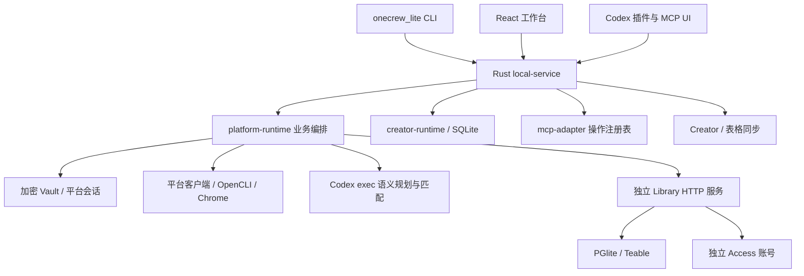

# onecrew_lite 完整模块结构与迁移边界

分析日期：2026-10-15。源码基线为公司 main `26eefcab4dab3b836937c2922ec33789c6c10975`，包含 Mac r4 构建提交 `8cedccf2a29433728e9c81f052c9d485df39a1ad`，两者文件内容相同。下列路径相对仓库根目录；Rust 代码证据额外省略 `onecrew_lite-rust/` 前缀。

本文覆盖所有一方模块、入口、契约、存储与发行边界；未对 5546 个文件逐行做安全证明，未在本轮重新执行所有测试。测试数量属于静态盘点，实际已执行验收另见交接说明。

## 1. 顶层结构与完整性

| 基线目录 | Git 跟踪文件数 | 说明 |
| --- | ---: | --- |
| onecrew_lite-rust | 2720 | Rust CLI、服务、业务、平台、工作台、MCP UI、插件与构建 |
| onecrew_lite-library | 2419 | 独立 TypeScript 表格服务，其中 Teable vendor 2218 文件 |
| onecrew_lite-access | 403 | 旧授权发行服务快照，与当前生产代码不同 |
| 根文件和 .github | 4 | 说明、忽略规则、属性与候选构建工作流 |

源码基线合计 5546 文件；本次文档文件另计。没有 gitlink 子模块，依赖锁文件受版本管理；node_modules、target、dist、缓存和私人配置按规则排除。Windows r3 声明的源码提交尚未找到，因此完整性范围是“已知公司 main 的全部受版本管理源码”，不代表已恢复 r3 全部源码。

## 2. 运行关系

CLI、网页和 MCP 共用业务运行时。Library 自己管理数据库、登录和服务生命周期；当前账号不一致问题发生在这两个运行时之间。目标统一账号与生命周期时，要同时保留账号所有权、事务边界和后台任务。

## 3. 全部 Rust crate 对照

35 个 crate 均来自 `onecrew_lite-rust/Cargo.toml` 的 workspace.members。建议模块名称表示职责，不要求机械拆成 35 个 npm 包。

| crate | 当前职责 | 目标归属 |
| --- | --- | --- |
| onecrew | CLI、启动、登录、workspace、setup、插件 | apps/service/cli |
| local-service | 进程、Web、IPC、后台任务、更新锁 | apps/service |
| platform-runtime | 连接、凭据、搜索规划、评分、Library 编排 | packages/application |
| creator-runtime | 创作者、搜索、外联、邮件、业务 SQLite | packages/domain、storage |
| domain | 账号与凭据公共类型 | packages/contracts |
| access-client | 发行元数据、邮件 OAuth | packages/access-client |
| creator-sync | 浏览器配对、凭据、快照与云同步 | packages/sync |
| local-vault | 加密存储、密钥文件、升级 | packages/vault |
| platform-sessions | 平台会话恢复、X 复用、Telegram 代理 | packages/sessions |
| proxy | HTTP/SOCKS、出口检查、本地转发 | packages/network |
| chrome | 浏览器识别、隔离目录、登录、Cookie 解密 | packages/browser-login |
| opencli | 受限子进程、扩展和版本检查、来源解码 | packages/opencli-bridge |
| codex | 插件生成、安装、缓存和状态 | packages/client-adapters/codex |
| mcp-adapter | 操作注册表、授权、发现/get/execute、MCP UI | packages/mcp |
| schema-manifest | JSON Schema、稳定哈希、JS 数值范围 | packages/contracts |
| dm-contracts | 私信对象、回执与失败类型 | packages/contracts/dm |
| email-contracts | 邮件/附件/批次供应商无关类型 | packages/contracts/mail |
| email-platform | 邮件供应商与发送者选择 | packages/providers/mail |
| gmail-platform | Gmail 读写、回执、Access OAuth | packages/providers/gmail |
| resend-transport | HTTP、限流、节奏和暂停 | packages/providers/resend |
| resend-client | 单封/批量调用与响应转换 | packages/providers/resend |
| resend-platform | 历史、附件、接收、域名 | packages/providers/resend |
| x-transport | Chrome TLS 指纹、代理与 HTTP | packages/providers/x |
| x-client | X 查询、GraphQL 和读写 | packages/providers/x |
| x-chat | 加密 X Chat、密钥恢复与消息解密 | packages/native-capabilities、providers/x |
| x-platform | X 业务门面与私信 | packages/providers/x |
| ig-transport | Instagram 设备与私有 API | packages/providers/instagram |
| ig-client | 操作和响应规范化 | packages/providers/instagram |
| ig-platform | Instagram 账号与私信门面 | packages/providers/instagram |
| tg-transport | MTProto、验证码、会话持久化 | packages/native-capabilities、providers/telegram |
| tg-client | Telegram 读写、群组、管理员 | packages/providers/telegram |
| tg-platform | Telegram 账号和私信门面 | packages/providers/telegram |
| youtube-transport | HTTP、并发及失败类型 | packages/providers/youtube |
| youtube-client | 查询和返回模型 | packages/providers/youtube |
| youtube-platform | 业务门面、身份与失败证据 | packages/providers/youtube |

主要职责证据位于各 crate 的 `src/lib.rs:1` 和 Cargo.toml；组合入口为 `crates/onecrew/src/main.rs:1`、`crates/local-service/src/startup.rs:1`。

## 4. 数据、凭据与进程约束

| 数据/运行状态 | 当前格式与约束 | 迁移要求 |
| --- | --- | --- |
| Creator 业务库 | SQLite schema 90，保留 27→90 升级链 | 首次 TS 迁移保留格式与字段，不同时迁入 PGlite |
| Vault | schema 4，兼容升级 2/3，32 字节私有主密钥文件 | 验证原密文格式和权限，不能生成空库覆盖旧库 |
| Vault 密文 | AES-256-GCM，12 字节 nonce 加密文/标签 | Node 实现精确分离 tag，用真实旧数据副本对照 |
| Library 库 | PGlite、Teable、迁移 001..004 | 保留完整目录与迁移历史，复用自己的仓储 API |
| 主服务身份 | owner lock、service JSON、IPC v1 | 停旧服务、核验实例身份、原子切换 |
| 主服务端口 | 数据目录哈希导出 22000–31999 | 保留浏览器 origin，冲突明确失败 |
| Library 身份 | PID、loopback URL、instance_id、control_token | 旧接口兼容期验证全部身份字段 |

证据：`creator-runtime/src/repository/sqlite/schema.rs:132`、`sqlite/mod.rs:59`；`local-vault/src/store/schema.rs:12`、`crypto.rs:18,48,81,119`；`local-service/src/paths.rs:10,14,61,95`、`ipc.rs:20`。

Vault 主密钥保存在数据目录，Chrome Cookie 读取另涉及 Mac Keychain、Windows DPAPI（`chrome/src/cookies.rs:204,247,280,329`）。JS 内存管理不能承诺 Rust zeroize 的同等效果；密钥不可转成日志或长期字符串。

主服务目录标识为 `io.onecrewai.onecrew_lite`。Library 实际默认目录为 macOS 的 `~/Library/Application Support/onecrew_lite_tables`、Windows 的 `%LOCALAPPDATA%/onecrew_lite_tables`，由 `ONECREW_LITE_DATA_DIR` 等参数覆盖（Library `src/runtime.ts:14–35`、`cli.ts:42–52`）。Library 旧 README 的 OneCrewConnect 路径不能用于迁移决策。

数据库与运行临时文件要分开：账户、表格、搜索、附件必须迁移；PID、锁文件、端口描述和旧 control token 必须重新生成。

## 5. 搜索能力完整范围

搜索包括需求解析、硬条件/偏好、平台和人数、关键词、预算、批准、分来源读取、分页、语言和身份核实、证据评分、去重、补词、暂停恢复、Library 同步与表格快照。

`creator-runtime/src/discovery.rs:1,72,164` 明确 Draft 不授权读取、只在确定失败后切词、每步仍核对 revision 和预算。`local-service/src/discovery_execution.rs:328,364` 先核验账号和任务，再做 Library readiness，之后才允许后台执行。新实现必须保持顺序。

当前语义引擎会检查 `codex login status`，再执行 schema 约束的 `codex exec`（`platform-runtime/src/discovery_draft/codex.rs:195,222`）。因此“接入 Codex 的插件”与“依赖 Codex 的语义服务”必须分别抽象；只新增 WorkBuddy MCP 配置不能消除后者依赖。

产品词整体理解已在 `codex.rs:131` 与 `search_query_guidance.txt:1` 修复。所有迁移必须保留 iPhone、复合品牌、无型号输入等回归。

OpenCLI 还覆盖 TikTok、Bilibili、Facebook、LinkedIn、Douyin、Pinterest、Pixiv、Reddit、Bluesky、HackerNews、网页等来源。必须逐项迁移命令白名单、扩展通信、版本检查和结果解码，不能只保留 Rust 直接客户端的平台。

## 6. Library 已有 TypeScript 基础

Library 0.1.4 已具备 TypeScript/Hono、React、PGlite/Kysely/Teable、MCP SDK 2、Node SEA。主要目录：

| 目录或文件 | 职责 |
| --- | --- |
| src/cli.ts、runtime.ts、index.ts | 服务生命周期、锁、状态、启动 |
| src/bootstrap.ts、app.ts | 依赖装配、HTTP/MCP、鉴权和网页 |
| src/database*.ts、database-migrations | 数据库、升级、恢复和历史校验 |
| src/modules/access、tenancy | 独立登录和 tenant 所有权 |
| src/modules/tables | Teable、projection、identity、contacts、capture |
| src/modules/browser、browser-extension | 浏览器连接与扩展 |
| src/modules/platforms | Library 残留平台能力，整合时消除重复所有者 |
| src/mcp、packages/contracts | 协议传输和共享 schema |
| web | 表格、账号、连接与 typed RPC |
| plugins/onecrew-tables | Library 自己的插件资料，不能重复注册为主插件 |
| tests | 41 个测试文件，含升级恢复和搜索同步 |
| scripts | SEA、发布、平台原生模块与许可证 |

`src/modules/access/service.ts:27–32,73–148,153–219` 定义登录状态和独立配对。`src/database-schema.ts:73–100` 将账号放在 PGlite，退出不删除业务。`tables/discovery-sync-http.ts:31` 私有 producer API 验证账号与来源。

主程序当前通过 Library API 写入，不能绕过所有权和 schema 直接改 PGlite 文件。`platform-runtime/src/library_sync/client.rs:426` 对未登录、授权中、不可用、无效响应和真正账号不一致分别报错；`library_sync.rs:17` 要求 `discovery-contacts-v2`、`recommendation-capture-v1`，同步按目录/campaign/account single-flight。

Library 自带恢复点验证与迁移事务（`database-upgrade.ts:16–34`、`database-recovery.ts:29–70`、`database-migrate.ts:40`），应复用。Rust 的 `development/scripts/migrate-lite-data.mjs:25–44` 只是停机后的目录复制工具，不是数据库或凭据格式转换器。

## 7. 前端、协议与插件

工作台 `onecrew_lite-rust/apps/web` 有 468 个 src 文件，React 19、TypeScript 5.8、Vite 7；`src/lib/local-runtime.ts:24–66` 使用 `/api/session` 和 `/api/commands/${command}`。保留旧 HTTP 契约可先复用全部页面。

MCP UI 有 180 个 src 文件及 41 个 preview 文件，使用 MCP SDK 1.x 和 ext-apps；Library 使用 SDK 2。工作台 Zod 3、TanStack table 8，Library Zod 4、table 9。不能在业务迁移时同时盲目升级所有依赖。

Rust schema-codegen 当前生成 discovery/creator-sync 契约；新共享契约必须有唯一来源，同时保留旧 schema ID、hash、JS safe integer、operation ID、结果引用与 continuation。

MCP 具有统一/compact/领域/skills 多表面，完整路径由 `crates/mcp-adapter/src/server/surface.rs:38` 定义。不得删减领域入口或绕过确认与幂等。Web 仍须保留 loopback、Host/Origin 检查、HttpOnly/SameSite Strict session 和 POST CSRF（`local-service/src/web/auth.rs:1`）。

Codex skill 位于 `integrations/codex-marketplace/plugins/onecrew/skills/onecrew/SKILL.md`：先状态检查、选择连接、工具发现/get/execute/present，并将安装动作保留在明确 CLI 命令中。新客户端 adapter 与语义 provider 分开；WorkBuddy 在真实宿主验收之前只属于未来接入目标。

## 8. 邮件、私信、同步与导入导出

DM 的确认、幂等、关系和审计属于 Creator owner，平台只执行已授权发送（`dm-contracts/src/lib.rs:1`）。Gmail 批次后台每两秒运行，关闭网页不停止任务，异常留下 uncertain，不能自动重发（`local-service/src/gmail_bulk_worker.rs:1`）。Resend 还包含附件、历史、接收、域名和发送节奏。

Telegram 的验证码/2FA/QR、群组/频道/管理员、session 与代理；X Chat 的密码学与恢复；Instagram 会话和身份均属于保留范围。

Creator JSON Bundle、XLSX、字段映射、自然键、预览/确认/冲突、幂等及导入回执需要完整移植（`creator_import.rs:1`、`creator_transfer.rs:82`、`creator_transfer_xlsx*.rs`）。快照 supervisor 有独立关闭期限；表格云同步按用户同意、8 MiB 分片、内容哈希和 pending 重试运行（`local-service/src/table_sync.rs:1,19,81`）。

## 9. 构建、安装与官网

Rust 使用 1.98.0 工具链。`development/scripts/build.sh` 构建网页/MCP UI，再 `cargo build --locked`。`package-workspace.mjs:34–63` 验证两个程序的目标、版本、大小和哈希；`:88–108` 分离本体安装、搜索依赖准备、Codex 接入和账号验收。Mac 安装器先 staging、校验、停止旧服务、原子替换并保留恢复目录。

Library 已有 SEA 三平台能力及目标清单：`scripts/build-binary.mjs:135,177–189,319–386`；`build-release.mjs:23,128–187` 固定 Node 26.7.0、官方 runtime 校验、平台组包。直接复用 Lite 这部分基础。

Windows 当前分 verify/service/start/opencli/codex/library 六步。新安装器需覆盖中文/空格路径、后台退出、重启、旧标准版与 Pro 共存。`.github/workflows/workspace-candidates.yml` 生成候选包及 pending-native-acceptance 状态；生成候选不等于生产发布。

仓库内 `onecrew_lite-access/` 是旧快照。当前公司 Access 实际发布来源为 `3a40933f19c29de413687c4f839699de90bb7d9a`，分支 `codex/release-lite-r3-preserve-pro`；发布文档 MR !6 已入 lite。最新 Lite 合同在公司 Access `src/cli-distribution/lite-contracts.ts:4–23`，schema1/product onecrew_lite，含 library_version、client_adapters、target/key/size/sha256/minimum_os。单服务迁移必须同时版本化这些合同、安装说明、组件检查及平台汇总。

## 10. 关键技术门槛与验证范围

- Chrome Cookie：Keychain、DPAPI、文件锁及权限，需要实际 OS 验证。
- X：wreq Chrome TLS 指纹不能以普通 fetch 代替后宣称等价。
- Telegram：grammers session 转换或明确重新授权的保留数据流程。
- X Chat：vendored chat-xdk 与 juicebox-sdk 的兼容与许可证，禁止自行重写密码学后未经验证上线。
- JS/SEA 原生依赖必须纳入每个平台 manifest 与签名流程。

crates 静态盘点为 1243 文件、2723 个 test 标记、127 个 ignore 标记。遗留测试含 fixture/mock，不能替代真实迁移验收。本轮未重新执行这些测试；迁移计划要求真实本地服务、授权账号和原生平台验收，并将未完成项明确阻断对应发布。
