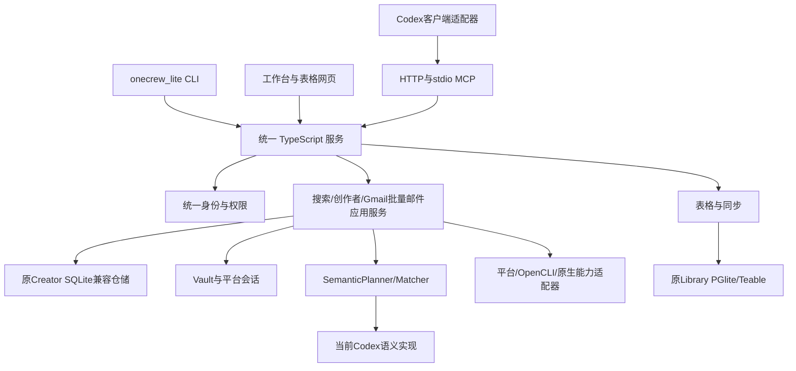

# onecrew_lite TypeScript 与统一程序迁移计划

状态：TypeScript 独立统一程序已经实现，Windows 当前配套构建为 candidate-87 / R8.1。更新日期：2026-10-19。产品版本 0.7.1；Mac ARM / Intel、宿主状态卡实际按钮及许可全文缺口未完成，productionReady 保持 false。逐项实证、发布门槛和下一步以 [当前交接记录](14-handoff-status-and-next-plan.md) 为准。

## 1. 目标、交付物和停止边界

目标是把 Lite 的业务主服务迁移到 TypeScript/Node.js，整合现有 Library，交付统一安装包、账号入口、服务生命周期、网页入口和构建发布流程。保留 [当前批准范围](08-current-scope.md) 的业务、历史数据和 Codex 接入；对外发送仅邮件页 GmailBulk。产品名称统一为 `onecrew_lite`。下列任务的原完成条件均受当前范围约束，已退役发送不重新实现。

最终交付物：完整新源码及锁文件、旧数据兼容/迁移器、Codex adapter、旧协议兼容层、Mac ARM/Mac Intel/Windows x64 安装候选、文件和构建来源清单、签名状态、原生验收记录、官网兼容改动、分批发布与回退文档。

实现位于独立 TypeScript 工作区，当前证据见 [Windows 配套验证](28-sync-and-table-loading-windows.md)。本机已按用户授权升级并保留原数据与登录；线上下载切换、生产部署和实际发送分别要求明确授权。访问公司资源需要执行人的授权。当前没有 Mac 设备，Mac ARM 和 Mac Intel 验收保持未完成。

## 2. 已确定的目标架构

采用一个 TypeScript 应用服务，复用现有 Lite Library 的 Hono、PGlite/Teable、SEA 和升级恢复基础。保持一个账号服务和一个 Principal/TenantContext。原 Rust Creator SQLite 与 Library PGlite 暂保留各自格式，由同一程序统一管理；语言迁移不同时强制重写全部业务数据库。

主业务代码全部迁入 TypeScript。浏览器系统能力、TLS 指纹、Telegram 公开读取等确需原生能力的部分通过受限 adapter 或原生扩展提供，纳入同一包的目标平台清单。架构允许受控原生依赖，和现有 Library/Pro 的 SEA 方式一致；不承诺所有依赖都是纯 JavaScript。原生技术验证按当前保留功能执行，X Chat 已移出范围。

业务模块接收已验证身份与取消信号；不得自己读另一份 active account。表格与业务库通过应用层命令、outbox 和幂等键协调，不能假设 SQLite 与 PGlite 有共同事务。关键状态先持久化，外部调用结果再明确提交。

当前由 `onecrew_lite-app/` 与同仓库的网页、状态卡、适配器、契约和 Library 实现下列模块职责。旧工程已移除；历史数据升级使用本仓库固定测试资源，不需要旧语言工程或编译器。以下为模块职责，不要求创建同名空目录：

| 位置 | 职责 |
| --- | --- |
| apps/service | CLI、Hono、依赖装配、运行锁、服务生命周期 |
| apps/web | 统一入口、工作台、账号、表格；复用现有组件 |
| apps/mcp-ui | Codex MCP Apps 展示与宿主交互 |
| packages/contracts | 共享类型、JSON Schema、操作目录与版本 |
| packages/domain | 搜索/创作者/Gmail批量邮件状态与规则 |
| packages/application | 用例、权限、任务执行与跨库协调 |
| packages/storage | SQLite、PGlite、migration、备份、outbox |
| packages/identity、vault | 账号、设备授权、tenant、凭据加密 |
| packages/providers | 平台、邮件、浏览器与网络协议 |
| packages/semantic | Planner/Matcher 与模型实现 |
| packages/client-adapters | Codex；未来宿主各自独立目录 |
| packages/mcp、opencli-bridge | MCP 传输、兼容、受限子进程 |
| packages/native-capabilities | 原生扩展声明、平台资源与版本检查 |
| development/release、installers | 构建、校验、安装、上传和激活 |
| tests/acceptance | 真实数据库、进程、平台、宿主与安装验收 |

这是模块责任清单，开发时可在一个 package 内组织小模块，避免仅为层级建立空包。每个模块必须有实际输入/输出和唯一数据所有者。

## 3. 不可改变的产品与协议要求

1. Draft/预览不能启动搜索；开始或继续仍检查批准、revision、账号、预算与平台能力。
2. 搜索任务持久化，关闭网页继续；暂停、重启恢复、证据和已读取来源不丢失。
3. “苹果手机”保持 Apple iPhone 整体语义，缺型号时不能自行补造型号。
4. 授权、平台限制、超时、补词失败、同步失败保留独立错误；不吞错、不用空结果伪装成功。
5. 同步失败后的恢复只重试同步，不要求重新搜索、不重复平台读取。
6. 账号切换取消旧账号任务和页面缓存；旧 MCP 会话不能向新账号静默执行。
7. 对外发送只保留邮件页 Gmail 批量发送，仍需明确确认；幂等与 uncertain 状态保留，重启不自动重发。
8. 所有发布名、目录、插件和环境变量使用 Lite 独立命名，与标准版/Pro 共存。
9. 现有 CLI/Web/MCP 操作保持兼容；确需变化须先记录映射并提供版本协商，不能默默删除操作。
10. 安装本体与接入客户端分离。业务服务不依赖 Codex 插件目录；语义 provider 对 Codex 的依赖另行报告。
11. 新构建不得改写旧版本 R2 对象。旧私人入口可获取兼容说明；直接下载凭据按有效期和清单绑定规则处理。

## 4. 执行顺序与总体验收门槛

顺序为 M00 → M01/M02 → M03 → M04/M05 → M06 → M07/M08/M09 → M10/M11 → M12 → M13 → M14 → M15 → M16 → M17。可并行的工作必须避免修改同一协议或数据所有者，先冻结契约再并行。

| 门槛 | 条件 | 未通过时 |
| --- | --- | --- |
| G0 源码与能力基线 | 文件、版本、契约和全部功能清单可追溯；r3缺口单列 | 不宣称可重建Windows线上包 |
| G1 原生可行性 | 四项原生能力在目标系统真实验证 | 不承诺相应平台完整迁移 |
| G2 数据与身份 | 旧数据可读、账号隔离、恢复点和失败保留验证 | 不允许真实用户升级 |
| G3 功能等价 | 所有现有操作有实现与真实验收记录 | 不以删减功能发布“完整迁移” |
| G4 安装与宿主 | 三平台候选分别实机验收、Codex真实接入 | 不激活未验收目标 |
| G5 发布 | 对象完整回读、清单条件激活、官网和回退演练 | 保持现在线上版本 |

### M00：固定完整基线与源码来源

输入：接手分支、公司 main、Mac r4/Windows r3 发布记录。产出：source ledger、能力清单、操作目录、数据目录与依赖清单。

- 记录源码 commit/tree、锁文件、运行时版本、原生目标、文件数量与许可证。
- 将35个crate、Library、前端/MCP UI、OpenCLI来源、插件全部映射到新模块。
- 获取 Windows r3 的实际源码、锁文件、构建说明和逐项实机记录；在获得前保持“来源未核实”，不能用其他提交冒充。
- 识别现有接口中只供内部使用、已发布给插件、用于官网安装的三类契约。
- 交付 `baseline-inventory` 与逐功能状态表，迁移状态初始均为未开始。

验收：干净克隆包含全部已知受版本管理源码；无缺失子模块；已知发布提交可定位；每项现有操作有归属和验收编号。停止边界：只读基线，不复制客户数据库或令牌入仓库。

### M01：四项原生能力实证

输入：当前 Rust 行为、Library SEA 构建基础；依赖 M00。产出：固定版本的依赖选择、三平台原型及调用契约。

- Chrome：真实读取经授权的浏览器身份，验证 Mac Keychain、Windows DPAPI、权限拒绝、浏览器占用与中文路径。
- X 网络：固定成熟 wreq 绑定或等效受维护原生能力，验证 TLS 指纹、代理、取消和错误映射，普通 fetch 不视为替代证据。
- Telegram：读取旧 session 格式并验证授权恢复；无法迁移的格式须有明确的重新授权流程且业务历史保持。
- X Chat：移出范围，不打包相关发送、恢复或加解密能力；旧历史按数据归属保留。
- 每项记录 CPU/OS/依赖版本、构建命令、实际调用、结果和错误处理；不得上传会话或私钥。

验收：三个目标分别完成本项真实平台检查；缺少账号或设备时标为阻塞，不能用 mock 或仅编译成功代替。确定原生能力清单后，才能锁定最终 SEA 资源和构建方案。

### M02：冻结契约和兼容目录

输入：旧 operation registry、CLI、Web commands、MCP surfaces、Library producer API；依赖 M00。

- 导出操作名、输入/输出 schema、批准要求、错误码、分页/continuation、result_ref、MCP资源 URI。
- 为旧CLI命令和 `/api/commands/*` 建兼容映射，保留老插件必要入口。
- 统一 JSON Schema 规范化与稳定 hash，明确 JS 安全整数、时间戳、空值/未知值规则。
- 新 TS contracts 成为新实现唯一来源，旧 Rust schema 作为固定对照，禁止两份同时手改。
- 冻结当前 Library capabilities 与结果同步规则；定义内置表格能力替代独立 Library 的版本协商。

验收：所有已发布操作逐项有“保持/适配/需审批变更”记录；没有未归属或静默删除；真实旧插件调用兼容服务能够读取状态与工具目录。

### M03：建立统一服务和开发构建入口

输入：M01依赖决策、M02契约。产出：新工作区、CLI、Hono、依赖装配、日志和停止流程。

- 固定 Node/pnpm/TypeScript、唯一新锁文件；先复用已验证的 Library SEA 工具版本，再按单独依赖升级任务调整。
- 实现 start/serve/stop/status/workspace，保持可机器解析状态，启动只能有一个 owner。
- 全新安装按最终规范化数据目录推导固定端口；旧版升级读取原有效目录和端口，作为新实例持久化的兼容身份，不因staging或迁移目标目录改变而重新计算。staging验收使用独立临时端口，正式激活必须先停旧进程，再绑定原端口；冲突明确失败，不能连接陌生服务或让两个实例共用旧origin。
- 实现 loopback、Host/Origin、session/CSRF、文件权限、更新排空和关闭期限。
- 日志携带操作/任务/实例 ID，移除令牌、Cookie、完整私人链接、密钥和个人内容。

验收：真实双进程并发启动只有一个 owner；端口冲突明确报错；正常退出/强制退出/重启可恢复；状态查询不会接受伪装的同端口服务。

### M04：Vault 与旧存储兼容

输入：Vault schema2/3/4、Creator schema27..90、Library迁移链；依赖 M03。

- 复用成熟 SQLite 库或经过验证的 Node SQLite API，不自制 SQL/parser。
- 首次迁移保持 Creator schema90和业务字段，Library保留PGlite/Teable；禁止直接混写PGlite文件。
- 保持密钥文件32字节、nonce/tag布局和原权限，验证Unix链接检查及Windows ACL策略。
- 原库只读快照后在独立staging目录验证；未来schema/未知migration历史直接失败。
- 创建迁移日志、源文件hash、恢复点和最终验收摘要；敏感内容留本机受保护目录。

验收：真实授权数据副本的所有表数量、主键、关系、联系人、证据、附件hash、凭据解密一致；损坏标签/缺密钥不生成空库；断电或取消后旧目录可继续使用。

### M05：统一账号与租户上下文

输入：两侧现有账号、Access设备绑定契约；依赖 M04。

- 定义唯一 AccountService、Principal/TenantContext、auth epoch、device/source身份和取消信号。
- 每次任务/同步/发送开始前核对账号epoch；切换账号后阻止旧上下文发起新请求，结果不得进入新账号页面。已发出的邮件不因epoch改变丢弃回执：必须在原账号下持久化成功/失败回执或uncertain，再完成核对，不能自动重发。只有可安全取消的读取和未开始工作允许直接取消。
- 旧账号组合：双方同账号、仅主程序有账号、仅Library有账号、双方不同、双方过期、授权进行中、远端不可用；逐项明确处理。
- 同账号且凭据验证通过才能复用；不同账号要求用户选择并保持另一账号数据隔离，不能自动重归属。
- 旧来源凭据无法安全复用时，只要求必要重新授权，保留所有数据。统一UI显示授权缺口，不让用户再次分别登录两个程序。
- 表格模块使用进程内已验证身份，不再自行读取第二份 active account；旧私有HTTP仅兼容旧客户端且保持鉴权。

验收：账号矩阵全部真实验证；不存在跨tenant读写；授权取消、离线、过期、切换账号均有明确状态；旧MCP会话不能在新账号下继续。

### M06：迁移领域与持久任务基础

输入：creator-runtime领域模型、仓储；依赖 M04/M05。

- 迁移Creator、连接关系、联系人、自然键、导入回执、邮件、搜索Campaign全部保留模型；已删除发送功能的旧回执与历史按原账号保留。
- 迁移单写语义、事务、幂等、revision和预算检查；后台任务持久队列不能换成内存TTL缓存。
- 任务状态包括准备、批准、运行、暂停、需证据、失败、完成、提交结果未知；实际命名以M02旧合同为准。
- 采用持久outbox协调SQLite与PGlite，稳定幂等键包含账号/任务/操作/版本；记录可重试与不可自动重试原因。
- 服务关闭先停止接收新工作，再排空安全步骤并记录未确定状态。

验收：真实数据库上重启、进程终止、重复请求不丢任务、不重复外部效果；旧历史记录与状态查询一致；业务操作由统一领域层执行。

### M07：平台会话、浏览器与 OpenCLI

输入：35crate平台清单、M01验证结果；依赖 M06。

- 逐项迁移YouTube、X、Instagram、Telegram公开读取所需的连接、会话恢复和只读契约；用户对外发送仅保留邮件页 Gmail 批量发送。
- 保留Telegram QR/验证码/2FA、群组/频道/管理员读取及代理约束；删除X Chat和各平台私信发送与远端私信同步。
- OpenCLI迁移所有已注册来源、受限命令和结果解码；维护版本、Chrome扩展与通信检查。
- 网络和账号租约按账号隔离，明确超时、限流、代理失败、登录失效、取消和平台限制。
- 新实现不把任意shell命令暴露给MCP或网页。

验收：每个现有来源至少完成真实身份恢复、只读、分页和失败退出；写入在专用测试账号获明确授权后验收。任何缺失平台留在阻断清单，不能按“主要平台已好”关闭任务。

### M08：搜索规划、语义与完整执行流程

输入：现有discovery/Codex/OpenCLI；依赖 M06/M07。

- 分离 `SemanticPlanner/Matcher` 与 `ClientAdapter`。当前语义实现仍可调用经授权的Codex CLI，但不让业务层依赖Codex插件路径。
- 迁移需求、硬约束/偏好、产品锚点、平台、人数、语言和查询生成；schema验证失败直接报错。
- 迁移分页、证据、身份、评分、重复合并、预算、补词轮次和停止原因。
- 开始前统一账号/表格readiness检查；任务过程中仍校验账号和revision。
- 保持暂停/恢复/调整条件、已读取结果不重复、同步失败只重试同步。
- 保留明确的语义未登录、超时、输出错误、补词错误与平台错误，不退化为一个通用失败。

验收：iPhone与复合产品、缺型号、硬条件、人数不足、无新查询、账号切换、补词失败、进程重启、同步恢复逐项通过。结果必须来自真实读取且能追溯证据；不得用编造候选填满人数。

### M09：表格、同步与 Gmail 批量邮件

输入：Library模块、Rust相关业务；依赖 M06/M07，与M08共用契约。

- 将Library作为进程内模块，保留Teable表/字段/记录ID、语义值、排序、导入导出、projection、identity、contacts和capture。
- 迁移Creator JSON Bundle、XLSX字段映射、预览确认、冲突与幂等回执。
- Creator生产云快照上传保持原实现的Retired状态；动态表格同步保留用户同意、账号绑定、8MiB分片、内容摘要、序列和恢复队列。
- 迁移邮件页Gmail批量发送的冻结草稿、确认、暂停、恢复、取消、永久尝试标记和回读；旧邮件及发送回执保持可读。删除单封用户发送、MCP Resend、私信及专用发送审核入口。
- 提交结果未知的邮件不自动重发；先回读或明确人工处理。

验收：真实数据库与导出文件来回核对，表ID与记录引用不变；同步中断恢复无重复；获授权的发送/回读/幂等流程通过；没有授权的写操作标为未验收且阻断正式完整发布。

### M10：统一网页与 MCP UI

输入：现工作台468个src文件、MCP UI180个src文件、Library网页；依赖 M02/M05/M08/M09。

- 先通过兼容HTTP迁移现页面，合并账号和导航入口，保留搜索、线索、邮件、表格、连接与设置功能。
- 单一账号状态驱动全部页面，切换时取消请求并清缓存；授权提示只指向缺失步骤。
- 按模块处理Zod3/4、TanStack table8/9与MCP SDK1/2边界，不一次性升级所有依赖。
- 保留MCP Apps资源、尺寸、host capabilities、结果刷新和跨页面引用。
- 中英文文案同步，错误提示给出恢复动作，不能把普通错误误称账号不同。

验收：全部路由与主要操作覆盖；真实后端驱动UI；页面刷新、返回、重启恢复无丢失；Codex内MCP UI真实显示且引用正确。不得仅凭静态preview认定集成成功。

### M11：Codex 接入与未来宿主边界

输入：现插件模板/skill、MCP合同；依赖 M02/M03/M10。

- 固定Lite插件ID、命令、资源和marketplace来源；本体安装与connect-codex继续分开。
- 定义runtime/插件最低与最高兼容版本；版本不兼容时明确提示更新。
- 独立 `ClientAdapter` 接口：检测宿主、生成配置、安装/更新、状态核对、卸载自身注册；不得改其他插件。
- WorkBuddy仅预留adapter协议和接手任务；在获得其真实MCP/插件能力并实机验收后才能标为支持。
- `SemanticProvider` 另列能力和授权，不能把安装WorkBuddy理解为语义引擎已脱离Codex。

验收：全新Codex、已有旧插件、更新插件、重启、真实status/tool discovery/get/read-only execution/present全部通过；旧插件窗口内兼容，其他软件配置保持原样。

### M12：事务安装与旧版升级

输入：新程序、M04迁移器、M11接入；依赖前述功能门槛。

- 安装前系统/架构/磁盘/权限检查，下载后验证完整ZIP和manifest，拒绝路径穿越及符号链接替换。
- 安装目录使用Lite独立位置，保留旧CLI入口兼容；账号数据与可执行文件分开。
- 停止并核验旧服务，备份旧程序与数据库；在staging导入并验证，再原子激活。
- 新包从首次发布即只启动统一服务。升级时停用旧Library自动启动注册并验证其已退出、无数据库writer，再激活新服务；回退时才按恢复记录重新启用旧注册。兼容旧HTTP合同由新服务提供，不能用第二个Library进程实现。
- 新服务启动成功并检查数据后才更新当前版本指针；失败保留旧运行环境和诊断信息。
- 安装步骤不自动登录、不自动发送、不自动执行平台搜索；需要浏览器或重启时清楚提示。
- 处理Mac ARM/Intel、Windows权限、中文路径、服务注册、登录开机启动、标准版和Pro共存。

验收：新装、覆盖升级、重复运行、安装中断、锁占用、磁盘不足、损坏ZIP、数据迁移失败、重启与回退分别实机通过；旧用户数据没有被空目录替换。

### M13：统一 SEA 构建和发行清单

输入：Library现有构建脚本与M01原生矩阵；依赖 M12。

- 提供一条根构建命令，固定源码commit、产品版本、Node版本、依赖锁文件hash和目标平台。
- 分平台打入网页、MCP UI、原生模块、WASM/data、插件模板和许可证；缺任意必需项立即失败。
- runtime payload按hash解包至Lite缓存，检查路径和完整性，原子完成标记；缓存损坏明确修复或失败，不能运行部分旧资源。
- 每包生成 manifest、SHA256、构建来源和组件版本；统一产品版本，组件版本仅用于内部协议兼容。
- 未验收目标标记candidate，不上传为published；已有同版本不同内容不得覆盖，使用新版本或明确修订号。
- 记录冷/热启动、首次安装、更新、内存、包大小。相同机器和数据对比旧版，差异原因必须解释并审批接受，不虚构性能数字。

验收：三目标构建来源一致、干净机器无开发依赖可启动；解包后全部文件hash一致；原生模块架构正确；实机验收通过后才能进入正式分发。

### M14：Access 新旧发行合同兼容

输入：公司当前实际Access源码、旧schema1、旧r3/r4、M13新包。

- 从生产整合分支确认最新代码，不能部署本仓库旧Access快照。
- 为单服务设计明确的新manifest能力字段/版本；旧 `library_version` 不用虚假独立组件版本填充。
- 新旧指南按发行合同版本分流；旧包仍使用原双服务说明，新包说明一次授权和内置表格。
- 同时更新下载校验、组件check、后台平台汇总、macOS/Windows选择和中英文提示词。
- 保留 `onecrew_lite` 产品隔离、鉴权私人入口、凭据有效期、清单绑定、对象路径校验。
- 与Pro共享的代码必须做Pro分发回归；不修改Pro产品配置或安装逻辑。

验收：旧入口读取旧包/新包各自正确说明；所有目标HEAD/GET及hash正确；后台仅显示已验收目标；Pro保持既有版本和路径；失效/无权链接明确拒绝。

### M15：完整验收与发布候选冻结

输入：M00–M14结果；依赖G0–G4。执行 [验收矩阵](04-acceptance-and-release.md)。

- 每个用例记录OS、CPU、源码、包hash、步骤、实际结果和证据，不能只写“通过”。
- 测试用真实本地进程和真实数据库；外部读写使用授权测试账号，不新增mock或伪造结果。
- 旧遗留单测可以提供辅助信息，不能替代本次真实迁移与平台验收。
- 所有失败修复并重新验证受影响路径；用例阻塞须明确原因，不能划成通过。
- 冻结候选后如代码/依赖/安装器改动，重新构建并重新执行受影响验收，包hash随之更新。

验收：零未解释失败；所有现有功能有覆盖；原生平台、数据、账号、安全写入、Codex与官网全部达标。Windows r3来源仍缺时，须明确该升级路径无法承诺已覆盖，不能把旧包验收替代r3验收。

### M16：签名、发布和验证

输入：冻结候选及真实验收记录；依赖M15。

- Mac完成Developer ID签名、公证及必要票据；Windows完成代码签名与新设备下载验收。证书/密钥仅在受控签名环境。
- 若发布仍无签名，必须由用户对明确版本和影响作出例外决定，记录为已知限制；不能写“签名已通过”。
- 先部署兼容新旧manifest的Access，再上传独立对象，完整回读SHA256，最后按ETag条件切换清单。
- 上传与激活分离；多人发布时ETag冲突立即停止，重新核对线上版本，不覆盖他人发布。
- 从真实官网生成的私人入口读取中英文指南，再HEAD和完整GET验证各平台。
- 记录GitHub/GitLab提交、MR、构建来源、运行时、包hash、Worker版本、清单ETag、发布时间和回退对象。

验收：官网用户可完成下载安装、授权、Codex接入和状态检查；后台平台完整；旧入口兼容；Pro回归通过。完成后更新仓库文档与MR说明。

### M17：升级后观察与旧组件退役

输入：已发布版本与回退窗口；依赖M16。

- 在用户允许的范围记录脱敏错误类别和安装结果，不自动上传账号、Cookie、搜索内容或私人链接。
- 新旧版本数据隔离保留至明确回退窗口结束，不能提前删除旧数据库或安装包。
- 在回退窗口结束且获得清理授权后，清理保留的旧安装备份和到期兼容代码；新正式包的独立Library启动入口已在M12/M15发布前移除。保留源码历史与版本恢复记录。
- 原生依赖如果仍有必要，正式登记维护与构建责任，不隐藏在“临时兼容”目录长期无人维护。

验收：退役清单逐项关闭，受影响旧客户端有明确最低版本；用户数据恢复演练完成。后续功能开发与本次迁移缺陷分开跟踪。

## 5. 数据升级的具体算法要求

1. 发现旧安装及实际配置目录，展示确认的来源，检查Lite身份并拒绝标准版/Pro数据目录。
2. 查询旧版本/schema/账号所有权；不记录凭据内容。
3. 停止旧写入服务并持有迁移锁，确认无活动writer；创建可验证恢复点。
4. 在新staging目录复制原数据，拒绝相互包含路径、符号链接和已存在未知目标。
5. 验证SQLite完整性、PGlite migration历史、文件hash与账号映射。
6. 兼容读取Vault、保留Creator数据模型，在新账号服务里验证设备凭据；发生不同账号时中止自动激活。
7. 按各自引擎执行必要升级，写入outbox/幂等记录；不跨两个引擎假装原子事务。
8. 校验记录数量、关系、引用、附件、状态与权限；生成只含摘要的迁移报告。
9. staging验收使用隔离端口。确认旧主程序和旧Library均退出且旧自动启动注册停用后，新服务使用持久化的原端口身份启动，核对旧书签、浏览器偏好、本地读写及MCP状态，再原子切换安装指针；端口冲突立即停止激活。
10. 保留旧恢复点；失败不回写源目录。更新后的新增数据须在回退前导出或协调迁回，不能通过恢复旧快照静默丢弃。

## 6. 未确定项与处理责任

| 未确定项 | 责任任务 | 关闭证据 |
| --- | --- | --- |
| Windows r3 完整源码 | M00 | 实际源码commit、锁文件、可复现构建记录 |
| Chrome/X公开读取/Telegram公开读取的新依赖组合 | M01 | 三平台真实原型与固定依赖清单；Mac 验收待设备可用 |
| 单服务账号凭据复用范围 | M05 | 远端契约核实与账号组合验收 |
| 新manifest版本与旧指南兼容窗口 | M14 | 公司Access评审、旧入口回归 |
| 首发版本与可正式支持目标 | M15/M16 | 冻结候选、平台验收与发布记录 |
| 签名证书与公证配置 | M16 | 受控签名环境和真实系统验证 |
| WorkBuddy具体接入能力 | 后续独立adapter任务 | 官方协议、安装方式和真实宿主验收 |

这些项目已有明确任务和完成条件；缺少证据时保持未完成。开发者不应为了简化交付改变目标、删除功能或用未知来源Windows包替代可追溯构建。
